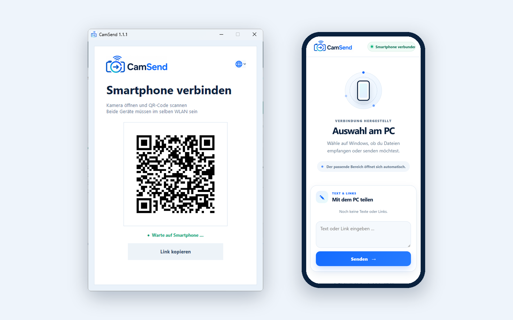
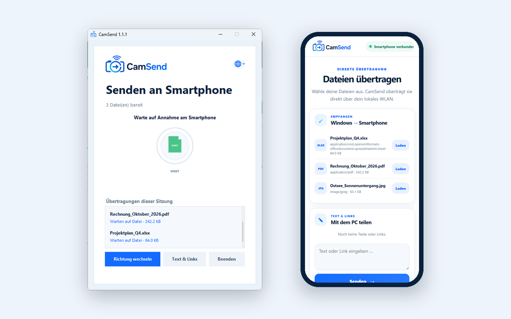
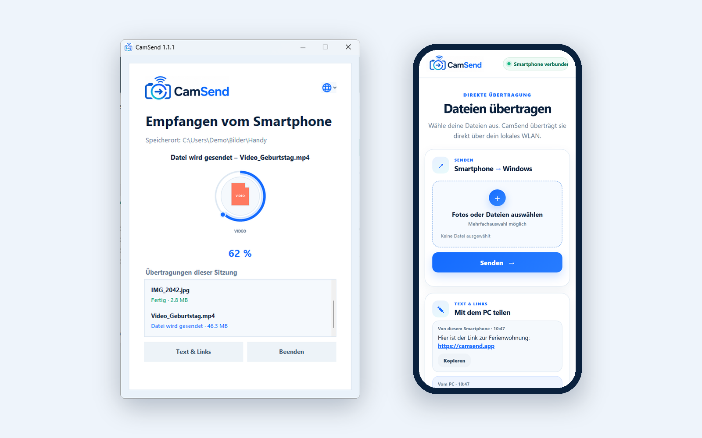
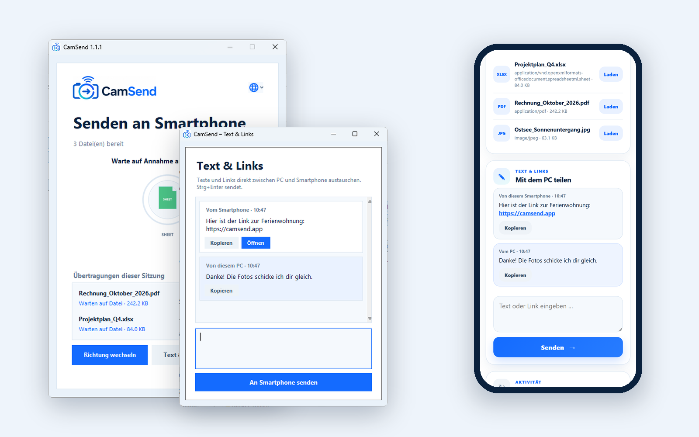

# CamSend 1.1.1

## Fixes

- Phone: the page no longer jumps down to the messages when a text arrives, so the upload area stays in view
- Phone: the green "connected" indicator shows a dot again instead of a bar on narrow screens
- Windows: long headings such as "Empfangen vom Smartphone" are no longer cut off

## Included from 1.1.0

- **Share texts and links** in both directions between Windows and the phone, with Copy and Open buttons
- **Explorer right-click menu:** "Send with CamSend" offers files directly; a running CamSend window takes them over

## Screenshots

> CamSend uses local HTTP and should only be used on trusted private networks.
